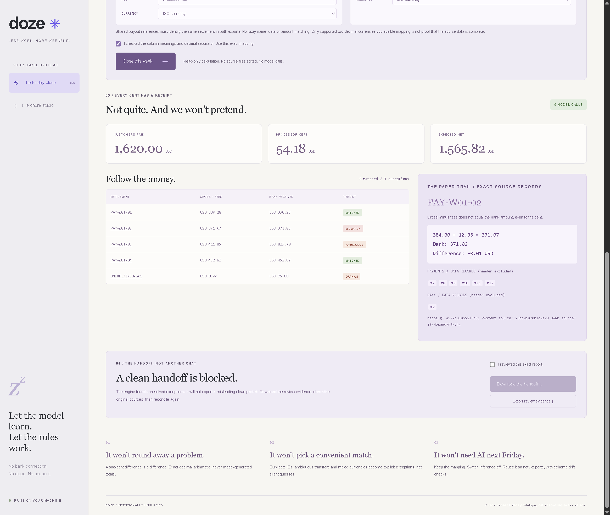
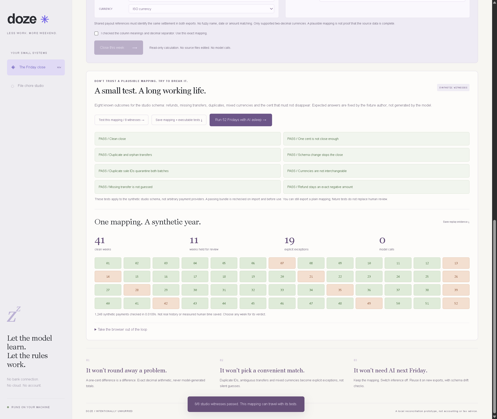
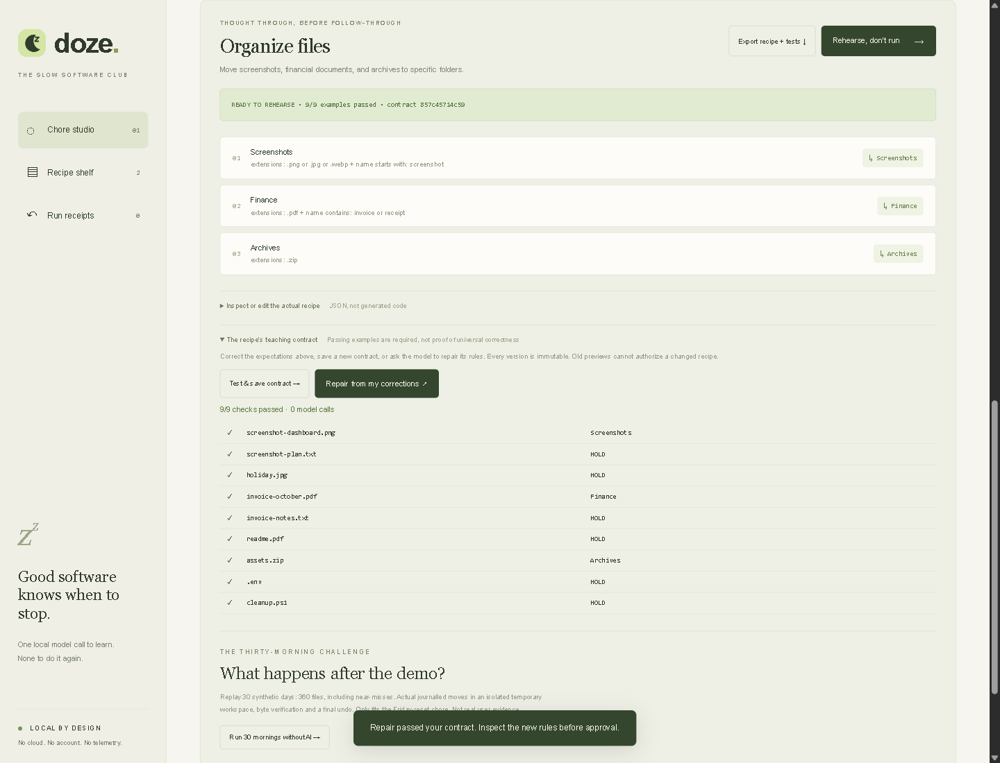
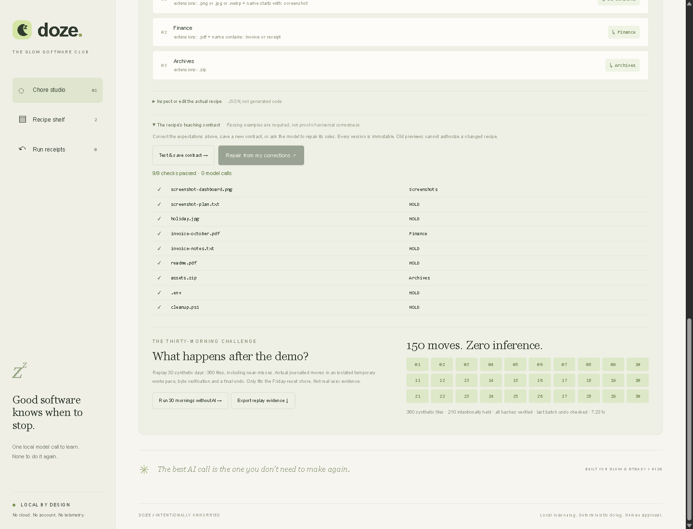

# Doze

**Teach the meaning once. Let the rules do the recurring work.**

## New primary workspace: The Friday Close

Doze now pairs payment exports with bank exports. A local model may propose a
column mapping from **headers plus an explicitly approved column explanation**.
CSV rows are not sent automatically. Humans review the mapping. Deterministic
Python matches exact settlement references, checks gross minus fees using
`Decimal`, and produces a hash-bound evidence ZIP only after explicit review.
No model calculates money. No bank connection, account access or payments.



### Start from a clean checkout

Python **3.11+** is sufficient for the application and recorded-result demo. No
Python or JavaScript packages, account credentials or model downloads are needed.
From the repository directory:

```sh
python -m doze.server
```

Open **http://127.0.0.1:8741** for Friday Close, or `/files` for the original file
studio. Choose **Replay the verified Gemma lesson / recorded result** to explore
without Ollama. The label distinguishes the historical model call from replay.
Human mapping and report review still apply. Optional fresh teaching requires
separately installed Ollama and an already-installed local model.

The development machine also has an existing demo at `http://127.0.0.1:8743`.
That is not a public demo URL or the default fresh-install port. Previously started
processes retain their earlier routing.

### Try the close without inference

1. Start with **A messy week**, then choose the explicitly labelled hand-written
   mapping. This is a sample, not an AI result.
2. Review the roles, approve the mapping and choose **Close this week**.
3. Inspect the one-cent mismatch, duplicate transfer and orphan transfer.
   Unresolved exceptions block a clean packet. Source-record buttons show the
   original values behind each settlement.
4. Put AI to sleep. Select **Next week**, review and reuse the mapping.
5. Review the clean report and download the handoff: reconciliation CSV, audit
   JSON, portable mapping, source hashes and a read-me. Original CSV contents
   are not included or modified. Changing the inputs invalidates report approval.

### What is verified, and what is not

- Browser checks passed with the **hand-written mapping**: three messy-week
  exceptions, a blocking one-cent discrepancy, four exact next-week settlements,
  approved ZIP response, server-side inference rejection, schema drift rejection
  and no horizontal overflow at 390px. See `evidence/close-smoke.json`.
- After two earlier refusals, grounding the successful JSON schema in the prompt
  and restricting roles to actual header enums produced **two successful live
  Gemma mappings** on different synthetic vocabularies. Explicitly unknown column
  meanings still refused. All three bounded cases passed, with no retries. See
  `evidence/close-grounded-teaching.json`. Earlier refusals remain preserved.
- The actual studio Gemma output also passed all eight witnesses, workflow
  import/revalidation, the browser handoff and twelve cold CLI checks with sockets
  blocked. See `evidence/close-workflow-smoke-gemma.json` and
  `evidence/close-offline-proof-gemma.json`. This is limited synthetic evidence,
  not proof of universal mapping reliability.
- Automated tests exercise 52 synthetic weeks without network access. This is
  repeatability evidence, not a real customer trial or measured time savings.
- No fuzzy matching, date-window logic, split transfers, FX conversion,
  multi-processor settlement composition or accounting integration. Unsupported
  records require human investigation. Refund gross can be negative; negative
  fees require review. Supported two-decimal currencies: USD, EUR, GBP, CAD,
  AUD, NZD and CHF. UTF-8 comma-delimited CSV only, 350 KB and 2,000 rows per input.
- Exact agreement cannot detect transactions omitted from **both** exports.
  Review source completeness. Totals exclude quarantined rows and are marked
  incomplete when those exist. This is a prototype, not accounting or tax advice.
- Profiles bind exact header sets and role mappings. Header reordering is allowed;
  missing or additional headers stop reconciliation. CSV formula-like IDs are
  neutralized in exported spreadsheet cells. All source values render as text.

## New: test the mapping, then take Doze out of the loop



### A mapping that travels with its tests

Choose **Test this mapping / 8 witnesses**. Fixed, human-authored expected
outcomes check a clean close, a one-cent discrepancy, duplicate and orphan
transfers, schema drift, duplicate sale IDs, mixed currencies, a missing transfer
and a negative-gross refund. These are tests of the known synthetic studio schema,
not an accounting certificate or a universal payment-provider integration.

The demo mapping passes **8/8**. Deliberately swapping gross and fees produces a
structurally valid mapping that passes only **1/8**. Failure cards show the exact
expected and observed results. A passing workflow can be exported with its
mapping, synthetic CSV witnesses, expected answers, versioned suite and hashes.

On import and before execution, Doze reruns the installed suite. Changing the
mapping, rewriting a bundled expected answer, or forging the exported pass badge
cannot make a failing **workflow bundle** run. The report binds the suite identity
as well as the mapping and inputs. The ZIP also carries `workflow.json` when used.
Plain mappings remain a separate, explicitly reviewed path without fixture
certification. Deliberately exporting a plain mapping removes the fixture gate;
this is a correctness aid, not an authorization or cryptographic-signature system.

### 52 Fridays, with inconvenient outcomes left intact

Put AI to sleep, then choose **Run 52 Fridays with AI asleep**. The server enforces
the sleep prerequisite. It reconciles **1,248 synthetic payments** across a fixed
year: **41 clean weeks, 11 held weeks, 19 explicit exceptions, zero model calls**.
Select a week to inspect its verdict and report hash. Nothing is scheduled or
written to your source exports. Runtime is measured, not claimed as human savings.

### No browser. No server. No Ollama.

Save a mapping or tested workflow, then run on exports you explicitly select:

```sh
python -m doze.close_cli --profile workflow.json --payments payments.csv --bank bank.csv --mapping-approved
```

Review the JSON report. Exit code is `0` for a clean close and `2` for exceptions
or rejected input. To produce a packet, rerun with the **exact reviewed hash**:

```sh
python -m doze.close_cli --profile workflow.json --payments payments.csv --bank bank.csv --mapping-approved --packet handoff.zip --approved-sha256 THE_REVIEWED_HASH
```

The destination must be a **new file**. Existing packets and source files are
never overwritten. Changed input, failed witnesses or unresolved exceptions block
the packet. Explicit mapping and report review are still required.

`python tools/prove_close.py` reproduces the offline proof in fresh Python CLI
subprocesses with socket creation blocked, using the saved hand-written workflow
and generated CSVs in an isolated temporary workspace under `.doze`.
See `evidence/close-offline-proof.json` for the twelve passed checks.

### When the model cannot teach it

Explain column meanings without pasting transactions. Changing the explanation
requires renewed consent. A refusal stays visible and does not trigger a retry.
**Map my columns myself / no inference** starts with blank roles, not guessed
defaults. Choose every role explicitly. Duplicate role assignments block the UI
and server validation. This path was verified with a different header vocabulary
and four exact settlements while inference remained blocked.

Current workflow evidence: `close-workflow-smoke.json`, `close-manual-smoke.json`,
`close-synthetic-year.json`, `close-tested-workflow.json` and screenshots 16-19.
Those original files use synthetic data and a clearly labelled hand-written
mapping. New `*-gemma.json` evidence separately follows the actual live-model
output, without overwriting the manual baseline.

### Replay the verified lesson without pretending it is live

Choose **Replay the verified Gemma lesson / recorded result** to load the exact
saved model mapping. The badge says **RECORDED GEMMA RESULT**, and its caption
distinguishes the original 4.85-second teaching call from the zero-inference
replay. This works while AI is asleep. Review the roles, test all eight witnesses,
then run the synthetic year or close a week. It does not claim the current inputs
were taught by that historical call.

The bundled recording is checked against the full live evidence in the test suite.
To reproduce its offline CLI proof after generating the saved workflow, run:

```sh
python tools/prove_close.py --recorded-gemma
```

The prompt fix follows Ollama's recommendation to include the JSON schema in the
prompt as well as its `format` constraint. The error branch and deterministic
validation remain intact. Two successful cases and one safe refusal do not measure
general reliability; a real user trial and measured human effort remain missing.

## Original workspace: file chore studio

Doze turns a plain-English file-sorting chore into a small, inspectable JSON recipe
using an installed local open-weight model through Ollama. Ordinary Python runs
the recipe after that. **Your labelled examples become an executable teaching
contract. If it fails them, the engine refuses to run, even through a direct API
request.** No inference loop, generated shell commands, cloud API,
account, telemetry, background watcher or scheduler.



## The next-level demo: catch it, teach it, switch it off

1. Open **Replay that real mistake**. This reconstructs the screenshot rule from
   our recorded first Gemma response. It is labelled, not passed off as new AI.
2. The recipe passes 8/9 examples. `screenshot-plan.txt` fails. The **server refuses
   execution**, even if a caller submits `approved: true` directly.
3. Click **Repair from my corrections**. One bounded local call gets your explicit
   examples, the previous recipe and deterministic failure feedback. No automatic
   retries. In our live check, Gemma restored the extension condition and passed 9/9.
4. **Put AI to sleep.** Doze blocks subsequent inference requests on the server.
5. **Run 30 mornings without AI.** Doze actually journals 150 moves across 360
   synthetic files, leaves 210 intentionally in place, verifies every expected
   file's bytes and checks the last batch's undo. Isolated temporary workspace,
   no effect on the visible sample workspace. This is not real user evidence.
6. Export **recipe + tests**. On import, Doze recomputes the contract locally.
   An imported "passed" badge is never trusted.



The revised local demo is running at **http://127.0.0.1:8742** in this development
session. The normal launch command below still defaults to port 8741.

Built from scratch on October 20, 2026 for the
[DEV Hacktoberfest Week 3: Slow and Steady challenge](https://dev.to/challenges/hacktoberfest-week3-2026-10-19).
This is a working local prototype, not a published contest entry.

## Run it

Python **3.11+**. No Python or JavaScript packages to install.

```sh
python -m doze.server
```

Open **http://127.0.0.1:8741**. Default mode touches only original synthetic sample
files inside `.doze/sample-workspace`. Their image, PDF and ZIP extensions are
sorting fixtures, not usable media. No real Downloads folder is accessed.

For AI compilation, install Ollama separately and choose an already-installed
**local** model in the UI. Doze does not install Ollama, pull weights or fall back
to a paid/cloud endpoint. Tested with `gemma4:12b-it-qat` on this machine. A
different model may produce different rules and must be checked.

Without Ollama, use the explicitly labelled **hand-written sample recipe** to
explore the engine. That fallback is not presented as AI output.

### The 90-second demo

1. Click **Try the Friday reset**, then **Teach Doze**.
2. Read the rules and the labelled examples sent with your instructions. The
   model proposes; it does not get filesystem access.
3. Click **Test & save contract**. `screenshot-plan.txt` must stay put even though
   its name starts with `screenshot`. Edit the examples for other chores.
4. Click **Put AI to sleep**. This closes Doze's server-side inference gate. It
   does not stop or unload shared Ollama models or alter other applications.
5. Click **Rehearse, don't run**. Inspect the exact five moves and held files.
6. Tick the approval checkbox and run. Open the durable receipt.
7. Add **tomorrow's batch**. Rehearse and run the same recipe with AI still asleep.
8. Click **Undo these moves**. The second batch returns to its original paths.

The screenshots in `evidence/` came from an actual automated browser run, including
local Gemma compilation, nine near-miss checks, inference-gate rejection, two
batches, undo and a 390-pixel-wide mobile layout.

`evidence/doze-walkthrough.mp4` is a 35-second captioned walkthrough assembled
from those verified browser captures. It is explicitly labelled as edited stills,
not a live screen recording. Nothing has been uploaded.

## Why this is more than an AI file organizer

There are already good open-source AI organizers with previews and undo. Doze
does not claim to invent those features. Its design question is different:
**can a model translate a recurring chore once, then get out of the way?**

```text
Plain English ── local model ──> constrained recipe
                                     │
                          inspect + near-miss tests
                                     │
                  model sleeps ──> deterministic rehearsal
                                     │
                            approve exact hashes
                                     │
                         journalled moves + receipt
                                     │
                           conflict-checked undo
```

The useful artifact is the recipe, not a chat transcript. Export it, inspect it,
edit it, share it, or import it on a machine without a model. No model is needed
to rehearse, apply or undo existing recipes.

### An actual model mistake, not a hypothetical safety story

Our first local compilation omitted the requested image-extension restriction
and invented a size condition. It was schema-valid but semantically too broad.
That is why schema validation alone is insufficient.

We added a hypothetical-file lab and improved the compiler instructions. The
next compilation retained all requested conditions. Regression tests include
the original overbroad-rule failure. A passing probe is evidence about those
examples, not proof that every future filename will be classified correctly.

### Teaching contracts, not self-reported confidence

- Examples are entered **before** compilation, in `filename → Folder` notation.
  Optional sizes use `filename | 2048 → Folder`. The model must infer general rules,
  not just answer each example separately.
- Local evaluation is deterministic. Passing every example, including a positive
  for each destination and at least one HOLD, is required to execute a recipe.
- "Certified" in internal JSON means only **passed these finite examples with
  this runtime**, not formal verification or an independent safety certification.
- Bare/legacy recipes still import and rehearse, but cannot execute without a
  passing teaching contract. Older receipts remain available for checked undo.
- Saving rules or expectations creates a new immutable recipe ID. A new rehearsal
  is required. Receipts include exact contract results and SHA-256 fingerprints of
  both the recipe and its examples. Unsaved UI edits invalidate pending approval.
- Repair is user-triggered, one call at a time. Failed repairs remain visibly
  blocked. You may fix the rules yourself without waking the model.
- Exported bundles contain rules and examples. They need no model to import,
  recheck, rehearse, run or undo.

**Why AI?** It is an optional rule-authoring interface for someone who can show
examples but does not want to write Boolean conditions or Python. If you can
already write these rules quickly, a hand-written recipe is a perfectly good
choice. Doze does not pretend that filename sorting requires an LLM.

## Recipe semantics

The supported operation is **move a top-level regular file into a relative
subfolder while preserving its filename**. No deletion, content interpretation,
renaming, recursive organization, external tools, notifications or schedules.

```json
{
  "name": "Screenshots, not every image",
  "description": "Move image files beginning with screenshot into Screenshots.",
  "rules": [{
    "label": "Screenshots",
    "when": {
      "extensions": [".png", ".jpg", ".webp"],
      "name_starts_with": "screenshot"
    },
    "folder": "Screenshots"
  }]
}
```

- First matching rule wins. Unmatched files are held.
- Different condition fields are **AND**; entries within `extensions` or
  `name_contains` are **OR**. Matching is case-insensitive.
- Also supports integer `min_bytes` / `max_bytes`.
- All schema fields are allowlisted. No expressions, templates, eval or shell.
- Dotfiles and an explicit list of executable/script/key/database suffixes are
  protected independently of model rules. See `PROTECTED` in `doze/engine.py`.
- Folders and links are not recursively scanned. Windows reparse points are
  rejected, including junctions on Python 3.11.
- At most 1,000 top-level entries and 128 MiB per candidate file.
- `HOLD` is reserved as an example outcome and cannot be a destination folder.

## Safety and recovery

Rehearsal records SHA-256 hashes. Execution rechecks **all** planned sources and
destinations before the first move, then rechecks each move. A preview can be used
only once. Files newly added after rehearsal are not silently included.

Moves use exclusive hard-link creation followed by source unlink, within the same
workspace. An existing target is never overwritten. Intent and progress are
committed to SQLite around these steps. Interrupted runs retain recovery receipts.
There is no unsafe copy/delete fallback if hard links are unsupported.

Undo preflights every affected file. It refuses changed destinations or source
path conflicts instead of overwriting edits. It handles the crash boundary where
both source and destination links exist. Empty destination folders are retained.
The state directory is bound to its original workspace so old plans cannot be
accidentally applied to a different folder.

The HTTP server binds only to `127.0.0.1`, validates Host, uses a per-process CSRF
token for writes, checks Origin, and serves a restrictive content security policy.
It has no third-party UI assets, analytics or CDN requests. Installed model
entries marked as remote/cloud are excluded. Ollama requests bypass HTTP proxies.

**Limitations:** This is not a hostile-multi-user sandbox or a backup system.
Do not run multiple Doze instances on the same workspace. External processes can
still race filesystem checks. Keep backups and start with sample copies. Model
translation can be wrong even when JSON validation passes. The loopback Ollama
service itself must be trusted. Power loss, unusual filesystems and concurrent
editing need more real-world testing before production use.

### Explicitly opt in to a real folder

Only after testing on copies:

```sh
python -m doze.server --workspace "D:/MyCopiedTestFolder" --state .doze-test
```

This disables synthetic file creation. Use a separate state directory for each
workspace. Nothing runs until you approve a rehearsal. Quit the server with Ctrl+C.

## Verification

```sh
python -m unittest discover -s tests -v
node --check doze/static/app.js
python tools/prove.py --compiled evidence/local-gemma-compile.json
```

The last command is optional: use `python tools/prove.py` for the hand-written
example, or supply a saved compiler result / recipe JSON to prove a compiled one.

Latest full suite: **120 tests run, 119 passed, 1 skipped**. The skipped symlink
test needs OS permission to create symlinks on Windows. Path and reparse-point
checks are implemented, but a skipped test is not a verified symlink scenario.
CI is configured for Windows and Linux with Python 3.11 and 3.12; remote CI has
not yet run because the repository has not been published.

Browser smoke testing uses the separately installed `cdp-chrome` skill's driver:
set `DOZE_CDP_DRIVER` to its `file:///.../cdp.mjs` URL, start a fresh sample server
and Chrome with CDP port 9222, then run `node tools/browser-smoke.mjs`. It operates
only on this local app, never authenticated account pages. It intentionally
creates demo recipes and receipts, so use a fresh sample state.

For the revised teaching-contract flow, start a separate synthetic server:

```sh
python -m doze.server --port 8742 --state .doze/next
node tools/teaching-smoke.mjs
```

The same `DOZE_CDP_DRIVER` setting is required. This script makes **one real local
repair call**, verifies failed-contract rejection through a direct API call, closes
the inference gate, runs the 30-day replay, executes a certified sample run and
checks undo. The fixed replay is an executable synthetic scenario, not a human
study, an independent benchmark or a test of semantic content understanding.

## Measured, not marketed

The verified warm local Gemma compile took **6 seconds** in the browser flow.
The earlier cold run took **49.22 seconds** and produced an overbroad rule. Those
are observations on this machine, not model benchmarks or latency guarantees.
All nine Friday-reset probes passed on the corrected recipe. Two five-file
batches ran while the server rejected inference requests. The second was undone.

We have not measured human time saved, power consumption, or superiority over
other organizers. "Take the afternoon off" is the product theme, not a benchmark.

The revised browser check is recorded in `evidence/teaching-smoke.json`. The live
repair output and its nine explicit examples are in
`evidence/teaching-live-repair.json`. The 30-batch result is in
`evidence/thirty-mornings.json`. These files separate measured outcomes from
claims: **150 synthetic moves, zero inference during replay**, not "30 days saved."

`evidence/doze-teaching-walkthrough.mp4` is the revised 32-second captioned demo,
assembled from those verified captures and explicitly labelled as edited stills.
The earlier `doze-walkthrough.mp4` records the first prototype's presentation.
Neither has been uploaded.

## Open innovation

Local open-weight inference makes the translation step inspectable and replaceable.
The resulting recipe outlives the inference service. You can change models without
changing the execution contract, or run a reviewed recipe without Ollama at all.
The source is MIT licensed. Model weights remain subject to their own licenses;
this repository contains no weights and does not relicense Gemma.

Original application code, UI and synthetic fixtures were built with AI assistance
through OpenCode. Python, SQLite, browser APIs and Ollama provide the underlying
runtime; no existing organizer's source was copied. The development machine's
existing Chrome automation driver was used for verification, not shipped as part
of the app.

## Competition readiness

- Local review package: [article draft](submission/ENTRY.md),
  [publication checklist](submission/REVIEW.md), [demo notes](submission/DEMO.md)
  and [original cover](submission/cover.png).
- New Friday Close walkthrough: `evidence/doze-friday-close.mp4`, 68.53 seconds.
  It shows actual app interactions using synthetic exports and a recorded Gemma
  mapping. The source capture has 62 sampled frames, encoded at 15 fps with elapsed
  timing preserved; it is not live teaching or a 15-fps source recording. Captions
  disclose this throughout. Seven recording assertions passed, no inference calls.
- `python tools/check_entry.py` compares article claims with saved evidence.
  All fourteen local checks passed. It explicitly reports publication NOT ready:
  owner approval, public repository/demo URLs, publication review, exact-commit CI
  and approved media uploads are still pending. User testing is optional, not an
  entry requirement. No measured human savings are claimed.
- Target: HF26 Week 3 overall and **Best Use of Gemma**.
- New project started October 20 within the October 19-25 window.
- Entry deadline: October 25, 2026, 11:59 PM PDT, per the official rules.
- Required post tags: `devchallenge`, `hf26challenge`.
- Writing quality is the most heavily weighted criterion. Explain the real model
  mistake, show the near-miss test, and demonstrate the inference gate plus reuse.
- Before entering: owner reviews the app and exact article, approves public repo
  publication, records/uploads a video or approves a deployed demo, then approves
  the DEV post. Nothing has been posted, deployed or submitted by this build.
