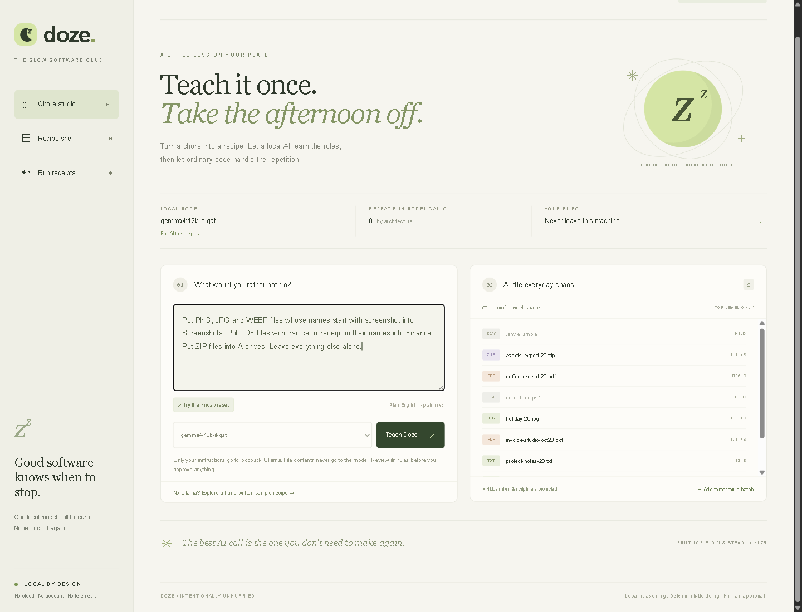

# Doze

**Teach a chore once. Let the model sleep.**

Doze turns a plain-English file-sorting chore into a small, inspectable JSON recipe
using an installed local open-weight model through Ollama. Ordinary Python runs
the recipe after that. No inference loop, generated shell commands, cloud API,
account, telemetry, background watcher or scheduler.



Built from scratch on October 20, 2026 for the
[DEV Hacktoberfest Week 3: Slow and Steady challenge](https://dev.to/challenges/hacktoberfest-week3-2026-10-19).
This is a working local prototype, not a published contest entry.

## Run it

Python **3.11+**. No Python or JavaScript packages to install.

```sh
python -m doze.server
```

Open **http://127.0.0.1:8741**. Default mode touches only original synthetic sample
files inside `.doze/sample-workspace`. Their image, PDF and ZIP extensions are
sorting fixtures, not usable media. No real Downloads folder is accessed.

For AI compilation, install Ollama separately and choose an already-installed
**local** model in the UI. Doze does not install Ollama, pull weights or fall back
to a paid/cloud endpoint. Tested with `gemma4:12b-it-qat` on this machine. A
different model may produce different rules and must be checked.

Without Ollama, use the explicitly labelled **hand-written sample recipe** to
explore the engine. That fallback is not presented as AI output.

### The 90-second demo

1. Click **Try the Friday reset**, then **Teach Doze**.
2. Read the rules. The model proposes; it does not get filesystem access.
3. Click **Test the near-misses**. `screenshot-plan.txt` must stay put even though
   its name starts with `screenshot`. Edit the examples for other chores.
4. Click **Put AI to sleep**. This closes Doze's server-side inference gate. It
   does not stop or unload shared Ollama models or alter other applications.
5. Click **Rehearse, don't run**. Inspect the exact five moves and held files.
6. Tick the approval checkbox and run. Open the durable receipt.
7. Add **tomorrow's batch**. Rehearse and run the same recipe with AI still asleep.
8. Click **Undo these moves**. The second batch returns to its original paths.

The screenshots in `evidence/` came from an actual automated browser run, including
local Gemma compilation, nine near-miss checks, inference-gate rejection, two
batches, undo and a 390-pixel-wide mobile layout.

`evidence/doze-walkthrough.mp4` is a 35-second captioned walkthrough assembled
from those verified browser captures. It is explicitly labelled as edited stills,
not a live screen recording. Nothing has been uploaded.

## Why this is more than an AI file organizer

There are already good open-source AI organizers with previews and undo. Doze
does not claim to invent those features. Its design question is different:
**can a model translate a recurring chore once, then get out of the way?**

```text
Plain English ── local model ──> constrained recipe
                                     │
                          inspect + near-miss tests
                                     │
                  model sleeps ──> deterministic rehearsal
                                     │
                            approve exact hashes
                                     │
                         journalled moves + receipt
                                     │
                           conflict-checked undo
```

The useful artifact is the recipe, not a chat transcript. Export it, inspect it,
edit it, share it, or import it on a machine without a model. No model is needed
to rehearse, apply or undo existing recipes.

### An actual model mistake, not a hypothetical safety story

Our first local compilation omitted the requested image-extension restriction
and invented a size condition. It was schema-valid but semantically too broad.
That is why schema validation alone is insufficient.

We added a hypothetical-file lab and improved the compiler instructions. The
next compilation retained all requested conditions. Regression tests include
the original overbroad-rule failure. A passing probe is evidence about those
examples, not proof that every future filename will be classified correctly.

## Recipe semantics

The supported operation is **move a top-level regular file into a relative
subfolder while preserving its filename**. No deletion, content interpretation,
renaming, recursive organization, external tools, notifications or schedules.

```json
{
  "name": "Screenshots, not every image",
  "description": "Move image files beginning with screenshot into Screenshots.",
  "rules": [{
    "label": "Screenshots",
    "when": {
      "extensions": [".png", ".jpg", ".webp"],
      "name_starts_with": "screenshot"
    },
    "folder": "Screenshots"
  }]
}
```

- First matching rule wins. Unmatched files are held.
- Different condition fields are **AND**; entries within `extensions` or
  `name_contains` are **OR**. Matching is case-insensitive.
- Also supports integer `min_bytes` / `max_bytes`.
- All schema fields are allowlisted. No expressions, templates, eval or shell.
- Dotfiles and an explicit list of executable/script/key/database suffixes are
  protected independently of model rules. See `PROTECTED` in `doze/engine.py`.
- Folders and links are not recursively scanned. Windows reparse points are
  rejected, including junctions on Python 3.11.
- At most 1,000 top-level entries and 128 MiB per candidate file.

## Safety and recovery

Rehearsal records SHA-256 hashes. Execution rechecks **all** planned sources and
destinations before the first move, then rechecks each move. A preview can be used
only once. Files newly added after rehearsal are not silently included.

Moves use exclusive hard-link creation followed by source unlink, within the same
workspace. An existing target is never overwritten. Intent and progress are
committed to SQLite around these steps. Interrupted runs retain recovery receipts.
There is no unsafe copy/delete fallback if hard links are unsupported.

Undo preflights every affected file. It refuses changed destinations or source
path conflicts instead of overwriting edits. It handles the crash boundary where
both source and destination links exist. Empty destination folders are retained.
The state directory is bound to its original workspace so old plans cannot be
accidentally applied to a different folder.

The HTTP server binds only to `127.0.0.1`, validates Host, uses a per-process CSRF
token for writes, checks Origin, and serves a restrictive content security policy.
It has no third-party UI assets, analytics or CDN requests. Installed model
entries marked as remote/cloud are excluded. Ollama requests bypass HTTP proxies.

**Limitations:** This is not a hostile-multi-user sandbox or a backup system.
Do not run multiple Doze instances on the same workspace. External processes can
still race filesystem checks. Keep backups and start with sample copies. Model
translation can be wrong even when JSON validation passes. The loopback Ollama
service itself must be trusted. Power loss, unusual filesystems and concurrent
editing need more real-world testing before production use.

### Explicitly opt in to a real folder

Only after testing on copies:

```sh
python -m doze.server --workspace "D:/MyCopiedTestFolder" --state .doze-test
```

This disables synthetic file creation. Use a separate state directory for each
workspace. Nothing runs until you approve a rehearsal. Quit the server with Ctrl+C.

## Verification

```sh
python -m unittest discover -s tests -v
node --check doze/static/app.js
python tools/prove.py --compiled evidence/local-gemma-compile.json
```

The last command is optional: use `python tools/prove.py` for the hand-written
example, or supply a saved compiler result / recipe JSON to prove a compiled one.

Latest full suite: **44 tests run, 43 passed, 1 skipped**. The skipped symlink
test needs OS permission to create symlinks on Windows. Path and reparse-point
checks are implemented, but a skipped test is not a verified symlink scenario.
CI is configured for Windows and Linux with Python 3.11 and 3.12; remote CI has
not yet run because the repository has not been published.

Browser smoke testing uses the separately installed `cdp-chrome` skill's driver:
set `DOZE_CDP_DRIVER` to its `file:///.../cdp.mjs` URL, start a fresh sample server
and Chrome with CDP port 9222, then run `node tools/browser-smoke.mjs`. It operates
only on this local app, never authenticated account pages. It intentionally
creates demo recipes and receipts, so use a fresh sample state.

## Measured, not marketed

The verified warm local Gemma compile took **6 seconds** in the browser flow.
The earlier cold run took **49.22 seconds** and produced an overbroad rule. Those
are observations on this machine, not model benchmarks or latency guarantees.
All nine Friday-reset probes passed on the corrected recipe. Two five-file
batches ran while the server rejected inference requests. The second was undone.

We have not measured human time saved, power consumption, or superiority over
other organizers. "Take the afternoon off" is the product theme, not a benchmark.

## Open innovation

Local open-weight inference makes the translation step inspectable and replaceable.
The resulting recipe outlives the inference service. You can change models without
changing the execution contract, or run a reviewed recipe without Ollama at all.
The source is MIT licensed. Model weights remain subject to their own licenses;
this repository contains no weights and does not relicense Gemma.

Original application code, UI and synthetic fixtures were built with AI assistance
through OpenCode. Python, SQLite, browser APIs and Ollama provide the underlying
runtime; no existing organizer's source was copied. The development machine's
existing Chrome automation driver was used for verification, not shipped as part
of the app.

## Competition readiness

- Target: HF26 Week 3 overall and **Best Use of Gemma**.
- New project started October 20 within the October 19-25 window.
- Entry deadline: October 25, 2026, 11:59 PM PDT, per the official rules.
- Required post tags: `devchallenge`, `hf26challenge`.
- Writing quality is the most heavily weighted criterion. Explain the real model
  mistake, show the near-miss test, and demonstrate the inference gate plus reuse.
- Before entering: owner reviews the app and exact article, approves public repo
  publication, records/uploads a video or approves a deployed demo, then approves
  the DEV post. Nothing has been posted, deployed or submitted by this build.
